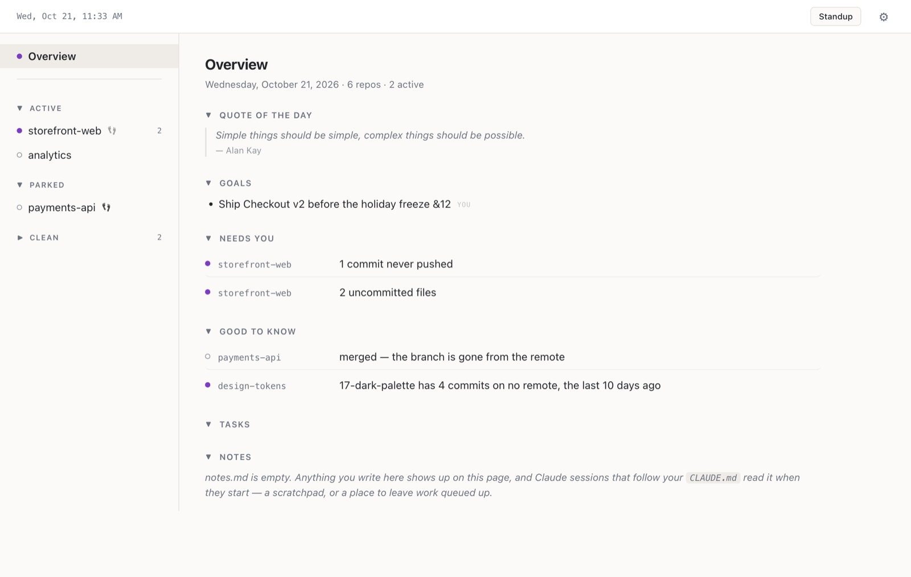
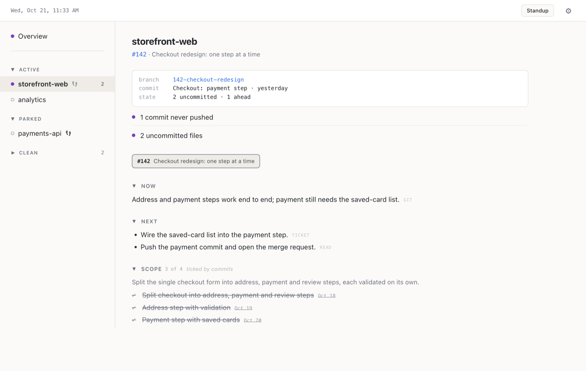
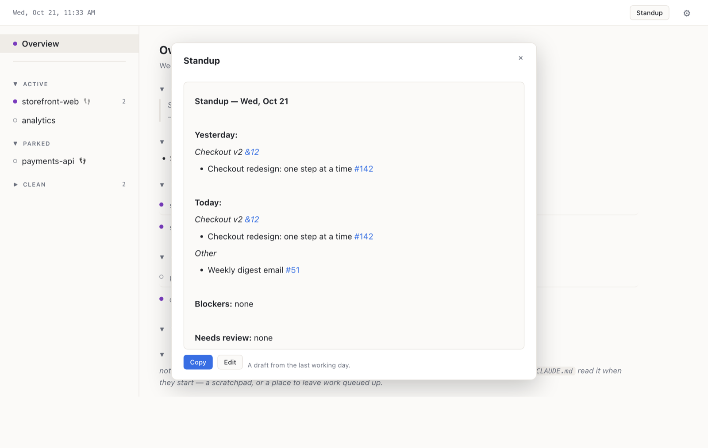
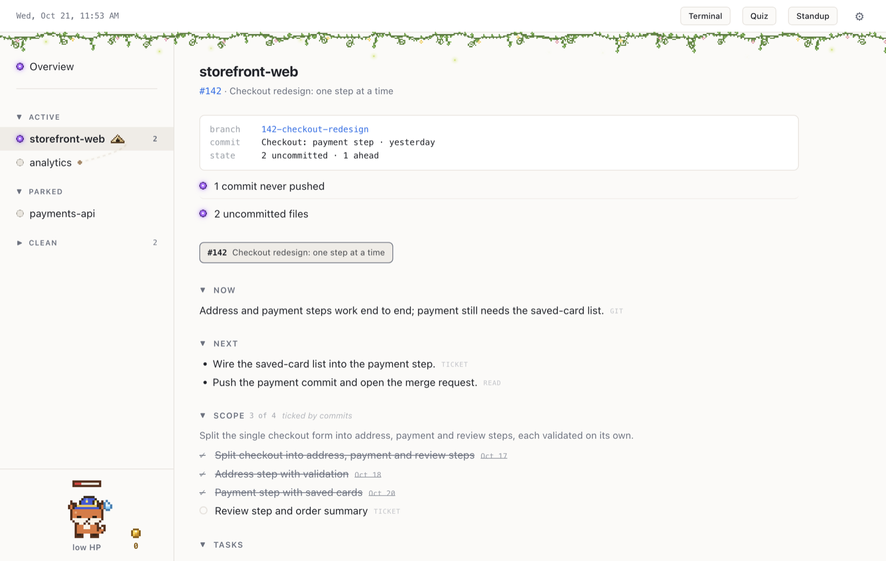

# Previously

*Previously, on your work…*

It answers one question — **where do I pick up?** — across every repo you
work in. It starts from the clones on your disk, and Sync adds what GitLab or
GitHub knows: comments, reviews, merge requests, tickets.



Like the recap before an episode, it is not a history. It is the selective cut of
what you need back in your head to resume: what is in flight, what to do next, what
quietly rotted while you were elsewhere. Git already stores the past perfectly well;
this is the working set.

What it catches that nothing else does is the cross-repo stuff. A branch you are
still sitting on three weeks after it merged. Four commits that exist only on your
laptop — on the branch you are on, or on one you left behind and never pushed. A
stash from five months ago. None of it is visible from GitLab, your editor, or any
single repo — only from something looking at all of them at once.

It is a Mac app with a window and a menu-bar item. It only touches the network when
it syncs, checks for an update, or makes a quiz.

What it is not: a tracker — GitLab owns tickets. A metric — the companion is capped
precisely so it cannot become a number to chase. A service — no daemon, no server,
nothing runs when you are not working.

---

## Quick start

**You need:**

- a Mac on macOS 13 or later
- `git`, `node`, and Xcode's command-line tools (`xcode-select --install`) — the
  installer checks for each and says how to get any that are missing
- your repos cloned in a folder, `~/Projects` say

**Optional:** `glab` (`glab auth login`) and/or `gh` (`gh auth login`), so Sync can
bring in comments, reviews and merge-request state from GitLab or GitHub; and
[Claude Code](https://claude.com/claude-code), to keep the written half of the page
current for you. Everything else works without them.

**Install** — clone (or unzip) Previously anywhere and run its installer:

```sh
git clone https://github.com/bretwphillips/previously.git
sh previously/install.sh
```

It asks which folder holds your repos (`~/Projects` by default), moves itself in
beside them, builds `Previously.app` into `~/Applications` on your own Mac — which
is what keeps macOS from blocking it — and opens it. It also offers to add the
Claude Code conventions to that folder's `CLAUDE.md`.

**First look.** The sidebar lists your repos as **Active**, **Parked** or
**Clean**. The **Overview** says what needs you across all of them — uncommitted
work, commits never pushed, branches whose merge request already merged, old
stashes — and clicking a repo opens its own pane.

One convention ties it together: **branches named `<ticket>-<title>`**
(`142-checkout-redesign`, GitLab's default). That is how a branch is matched to
its ticket.

---

## Where the story comes from

Each repo's pane has two halves, and keeping them apart is the whole point.



| | Written by | How current |
|---|---|---|
| Branch, uncommitted files, ahead/behind, last commit, **Needs you** | read from your local git | always — rebuilt every time you look |
| **Now / Next / Scope / Notes**, goals | Claude Code, you, or nobody | as of the last time it was written |

The git half needs nothing from you. The written half — what you're doing, what's
next, the ticket's scope — can come from any mix of three places:

- **Claude Code**, at checkpoints (a push, a branch or ticket change, parking work),
  following the conventions the installer adds to your `CLAUDE.md`.
- **You**, in the app: a pencil beside each section opens it as text.
- **Nobody.** Every ticket branch you're working on still gets its own tab, titled
  from the ticket once you've synced, with its recent commits and branches.

Every written line carries a small tag saying what it rests on: `ticket` (close to
the ticket's own words), `git`, `mr`, `you`, or `read` — **Claude's own inference,
to check before you act on it.**

---

## Everyday use

- **Spaces.** Work and personal projects don't have to share a dashboard. Each
  space has its own folders, notes, tasks, standup and sync schedule
  (Settings → Spaces); a menu at the top of the sidebar switches between them.
- **Markers.** A dot beside each repo and line says what kind of thing it is:
  red when someone else did something on yours, purple for work you haven't
  finished, green for anything else new. Bold means you haven't looked yet.
- **The menu bar** keeps listing what needs you with the window closed.
- **Standup** (`⌘G`) drafts your morning post from the last working day: what you
  did yesterday, what's planned today up to a weight limit, blockers, and what's
  waiting on your review — ready to copy into Slack.

  

- **Sync** brings in comments, reviews, merge-request state and ticket details.
  It's **Manual** by default — nothing is fetched until you click **Sync** — or
  set a space to sync daily, hourly or every 15 minutes, only while you're at
  the Mac.
- **Notes and tasks** are yours: `notes.md` for anything, tasks for work with no
  commit behind it. Both show on the Overview.
- **From a terminal:** `sh previously/show.sh` prints what needs you; add a repo's
  name for that one in full.

---

## Optional extras

All off until you turn them on in Settings:

- **A terminal drawer** along the bottom of the window, for Claude Code sessions
  that pick up where they left off.
- **A daily code quiz** on the code you've been working in.
- **A companion** in the sidebar whose mood follows how your work is going.
- **Quest mode**, which turns your tickets and commits into a small game, with
  themes to choose from.



---

## Updating

Once a day Previously asks GitHub whether there's a newer release. When there is,
a dot appears on the gear and **Settings → General** shows what's new, with
**Update**. Updating moves the folder to the new release with git and rebuilds
the app; your worklogs, notes, tasks and settings are never touched.

---

## What it will never do

- Contact GitLab or GitHub except to sync — when you click it, or on a schedule
  you set — and to check GitHub about once a day for Previously's own latest
  release, which you can turn off.
- Run in the background. No daemon, no cron; with the app closed, the laptop shut
  or you away, nothing happens.
- Cost tokens to display. The app is a Swift binary and a node script; no model is
  involved in showing you the page.

---

## More

- **[The guide](docs/guide.md)** — everything in detail: every section of the page,
  markers, the standup's rules, sync, the terminal, the quiz, the companion and
  quest mode, and the conventions for Claude Code.
- **[Development](docs/development.md)** — what each file does, rebuilding, and
  making a release.
